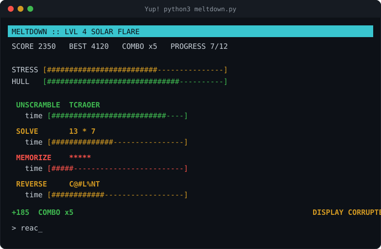

<div align="center">

# ☢️ MELTDOWN

### A stressful, fast-typing survival game that runs entirely in your terminal.


<br>



<sub>Yup ! Illustration of the game screen (Level 4: Solar Flare).</sub>

</div>

---

## 🚨 The Story

The space station is failing. Every other operator is gone. You are the last one at the console.

Alarms keep firing, the timers keep shrinking, and your stress keeps rising. Answer every alarm before it expires, or the hull will not hold. **How many levels can you survive?**

## ✨ Features

- 🎮 **7 handcrafted levels** that get faster and meaner, then **endless mode** after that
- ⏱️ **Multiple alarms at once**, each with its own countdown
- 🧠 **5 alarm types**: type, reverse, solve, unscramble, memorize
- 😰 **Stress and hull meters**. Lose either one and the station is lost
- 🔥 **Combo multiplier** for streaks, wiped out by one mistake
- 📺 **Random events**: corrupted displays and alarm surges
- 🏆 **Saved high score** between runs
- 📦 **Zero dependencies**: only Python's standard library

## 🕹️ Alarm Types

| Alarm | What to do | Example |
|---|---|---|
| `TYPE` | Type the word shown | `REACTOR` → `reactor` |
| `REVERSE` | Type the word backwards | `CORE` → `eroc` |
| `SOLVE` | Type the answer to the math | `7 + 5` → `12` |
| `UNSCRAMBLE` | Type the real word | `TCRAOER` → `reactor` |
| `MEMORIZE` | Type the code before it turns into `*****` | `48213` |

Capital letters do not matter. Answer in any order: your input is matched against all active alarms.

## 📈 Levels

| # | Level | New twist |
|---|---|---|
| 1 | Boot Sequence | Just typing words. Warm up. |
| 2 | Coolant Leak | Reversed words appear |
| 3 | Pressure Spike | Math problems join in |
| 4 | Solar Flare | Scrambled words and **corrupted displays** |
| 5 | Blackout | Memorize codes that vanish |
| 6 | Core Breach | **Surges** of up to 3 alarms at once |
| 7 | Total Meltdown | Everything, as fast as possible |
| ∞ | Endless Dread | It never stops getting harder |

## 💀 How You Lose

- **STRESS** goes up while alarms are active and every time you answer wrong. At **100%**, you crack.
- **HULL** drops **15%** for every alarm that runs out of time. At **0%**, the station breaks apart.
- Clearing alarms lowers stress, and finishing a level repairs a little hull.

## 🚀 Quick Start

### 1. Clone the repo

```bash
git clone https://github.com/<your-username>/meltdown.git
cd meltdown
```

### 2. Run it

**macOS / Linux**

```bash
python3 meltdown.py
```

**Windows**

```bash
pip install windows-curses
python meltdown.py
```

> 💡 Use a terminal window of at least **80 × 24** so every alarm fits on screen.

## 🎛️ Controls

| Key | Action |
|---|---|
| Letters / numbers | Type your answer |
| `Enter` | Submit the answer |
| `Backspace` | Fix a typo |
| `Ctrl + C` | Quit |

## 🔧 Make It Harder (or Easier)

All difficulty settings live in the `LEVELS` table at the top of `meltdown.py`:

```python
# name, flavour, quota, spawn_secs, alarm_ttl, max_active, pressure, kinds, glitch, surge
("CORE BREACH", "Alarm surges incoming.", 16, 1.7, 8, 5, 1.4, [...], True, True),
```

| Setting | Meaning |
|---|---|
| `quota` | Alarms to clear to finish the level |
| `spawn_secs` | Average seconds between new alarms (lower is harder) |
| `alarm_ttl` | Seconds you get per alarm (lower is harder) |
| `max_active` | Most alarms on screen at the same time |
| `pressure` | How fast stress builds per active alarm |
| `kinds` | Which alarm types can appear |
| `glitch` / `surge` | Enable corrupted displays or alarm surges |

Add your own words to the `WORDS` list to make it your own.

## 🗺️ Roadmap

- [ ] Power-ups (freeze time, repair hull, calm stress)
- [ ] Boss level with a long multi-part code
- [ ] Sound effects
- [ ] Local leaderboard
- [ ] Two-player mode

## 🤝 Contributing

Ideas and pull requests are welcome. Fork the repo, create a branch, and open a PR. New alarm types are the easiest way to add something fun: add one in the `Alarm` class and list it in a level's `kinds`.

## 📄 License

Released under the [MIT License](LICENSE).

---

<div align="center">

**Think you can survive Total Meltdown?** ⭐ Star the repo if you made it.

</div>
