<div align="center">

# ☢️ MELTDOWN v4.0.0

### A stressful, fast-typing survival game that runs entirely in your terminal.


<br>


<sub>Illustration of the game screen (Level 4: Solar Flare).</sub>

</div>

---

## 🚨 The Story

The space station is failing. Every other operator is gone. You are the last one at the console.

Alarms keep firing, the timers keep shrinking, and your stress keeps rising. Answer every alarm before it expires, or the hull will not hold. **How many levels can you survive?**

## ✨ Features

- 🎮 **7 handcrafted levels** that get faster and meaner, then **endless mode** after that
- ⏱️ **Multiple alarms at once**, each with its own countdown
- 🧠 **20 alarm types**: `type`, `reverse`, `solve`, `unscramble`, `memorize`, `sequence`, `binary`, `morse`, `decode`, `seq lock`, `hex/octal`, `logic`, `ping/port`, `typo hunt`, `vent mash`, `regex`, `symbol`, `checksum`, `cipher`, `dual-lock`
- 😰 **Stress and hull meters** — lose either one and the station is lost
- 🔥 **Combo multiplier** for streaks, wiped out by one mistake
- 📺 **Random events**: corrupted displays, alarm surges, and **station hazards** (`Overheat`, `EMP Flicker`, `Radiation Leak`, `Low Oxygen`)
- 🔋 **Power-ups**: freeze time (`freeze`), repair hull (`repair`), calm stress (`calm`), clear alarms (`clear`)
- 🛠️ **Reactor Bay Perks & Sector Navigation**: draft permanent upgrades and choose branching station sectors between levels
- 👾 **3 boss fights**: *The Sentinel*, *The Guardian*, and *The Core* (plus **Boss Rush** mode)
- ⚙️ **3 difficulty modes & Mutators**: Casual, Operator, Nightmare, plus *Glass Cannon*, *Blindfold*, and *Turbo*
- 🧪 **Training, Sandbox & Challenges**: Practice mode, Custom Sandbox (`SBX-...` shareable codes), **Daily Challenge**, and **Weekly Challenge**
- 📖 **Story events**: narrative transmissions and strategic choices between levels
- 👥 **Multiplayer**: Co-op (shared screen), Versus (seeded head-to-head), and **LAN / Room-Code Versus**
- 🎬 **Replay Theater & Ghost Racing**: watch saved runs at `1x`/`2x`/`4x`, race your personal-best Ghost bar, and export animated SVG replays (`--record`)
- 🧩 **Custom Mods**: load custom word packs (`~/.meltdown/words.txt`) and custom alarm plugins (`~/.meltdown/plugins/*.py`)
- 🎨 **Orbital Command OS UI**: 2-column telemetry cockpit, live ASCII Reactor Core, 4 color themes, unlockable skins, and CRT Hazard Box Game Over screen
- 🏆 **Top-10 leaderboard** with daily & weekly challenge rankings, **Operator Rank** (`S+`–`D`), and shareable Run Cards
- 🎖️ **19 achievements** and an in-game **Field Manual**
- 📊 **Detailed statistics**: accuracy, response times, longest combo, and more
- 💾 **Save & resume**: quit mid-run and continue later (`~/.meltdown/data.json`)
- ♿ **Accessibility options**: reduced flash, colorblind mode, large UI, timer numbers, ASCII progress bars
- 🔊 **Cross-platform audio**: non-blocking synthesized tones, combo chimes, warning pulses, and multi-tone chords (zero dependencies)
- 📦 **Minimal dependencies**: standard library only on macOS/Linux (`windows-curses` on Windows)

---

## 🚀 Installation

### Recommended (`pipx`)

```bash
pipx install meltdown-terminal
meltdown
```

`pipx` installs the game in an isolated environment and puts the `meltdown` command on your `PATH` so you can run it from any directory.

### Using `pip`

```bash
pip install meltdown-terminal

meltdown
OR

(ONLY IF 'meltdown' is not recognized)

python -m meltdown 

```

### Installing from source

```bash
git clone https://github.com/codest0411/meltdown.git
cd meltdown
pip install .
meltdown
```

### Windows Setup Notes

1. Install **Python 3.8+** from [python.org](https://www.python.org/downloads/) or Microsoft Store, and make sure **"Add Python to PATH"** is checked during installation.
2. When installing `meltdown-terminal`, `windows-curses` is installed automatically as a Windows dependency.
3. If `meltdown` is not recognized after `pip install`, add your Python `Scripts` folder to `PATH` (or use `pipx`, then run `pipx ensurepath` and restart PowerShell/CMD).
4. You can also always run `python -m meltdown`.

---

## 🎮 Usage

Launch the game from any directory:

```bash
meltdown
```

Show help, controls, and troubleshooting:

```bash
meltdown --help
```

Show installed version:

```bash
meltdown --version
```

Run as a Python module:

```bash
python -m meltdown
```

Export an animated SVG replay of your run:

```bash
meltdown --record
```

Configure Windows PowerShell `meltdown` function (if `.exe` wrappers are blocked):

```bash
meltdown setup-shell
```

---

## 🖥️ Supported Operating Systems & Requirements

- **Python:** 3.8 or newer (`>=3.8`)
- **Operating Systems:**
  - **Windows** (Windows Terminal, PowerShell, CMD) — automatically installs `windows-curses`
  - **Linux** (GNOME Terminal, Kitty, Alacritty, xterm, etc.)
  - **macOS** (Terminal.app, iTerm2)
- **Terminal Size:** At least **80 × 24** recommended so all alarms and HUD bars fit cleanly.

---

## 🕹️ Alarm Types

| Alarm | What to do | Example |
|---|---|---|
| `TYPE` | Type the word shown | `REACTOR` → `reactor` |
| `REVERSE` | Type the word backwards | `CORE` → `eroc` |
| `SOLVE` | Type the answer to the math | `7 + 5` → `12` |
| `UNSCRAMBLE` | Rearrange the scrambled letters | `TCRAOER` → `reactor` |
| `MEMORIZE` | Remember the code before `*****` appears | `48213` → `48213` |
| `SEQUENCE` | Find the next number in the pattern | `2, 5, 8, 11, ?` → `14` |
| `BINARY` | Convert binary to decimal | `10110` → `22` |
| `MORSE` | Decode the morse code | `.-  .-.  -.-.` → `arc` |
| `DECODE` | Identify the word from two corrupted versions | `R#CT$R \| R$@CT#R` → `reactor` |
| `SEQ LOCK` | Remember the direction sequence before it hides | `UDLRU` → `udlru` |
| `HEX/OCTAL` | Convert hexadecimal (`0x..`) or octal (`0o..`) to decimal | `0x2F` → `47` |
| `LOGIC GATE` | Evaluate boolean gate (`0` or `1`) | `1 XOR 0` → `1` |
| `PING/PORT` | Type the target port shown in the log | `ERR@CORE::PORT:8080` → `8080` |
| `TYPO HUNT` | Type the misspelled word in the pair | `ORBIT \| ORBXT` → `orbxt` |
| `VENT MASH` | Submit the short key 3 times to vent | `VENT (3 left)` → `vent` (×3) |
| `REGEX` | Type any string matching the pattern | `MATCH ^[a-z]{2}[0-9]{2}$` → `ab12` |
| `SYMBOL` | Map symbols (`1:^ 2:* 3:# 4:@`) to digits | `^ * # ^` → `1231` |
| `CHECKSUM` | Sum all digits of the packet ID | `PKT-4819 (SUM)` → `22` |
| `CIPHER +1` | Decode Caesar +1 shifted word (-1 each letter) | `BQQMF` → `apple` |
| `DUAL-LOCK` | Clear Stage 1 word, then Stage 2 word | `CORE` → `WARP` |

Capital letters do not matter. Answer in any order: your input is matched against all active alarms.

## 🎛️ Controls

| Key | Action |
|---|---|
| Letters / numbers | Type your answer |
| `Enter` | Submit the answer |
| `Backspace` | Fix a typo |
| `Esc` | Pause menu |
| `Tab` | Switch active player (Co-op mode) |
| `Ctrl + C` | Quit |

---

## 📸 Screenshot Gallery

<div align="center">

| Main Menu | 2-Column Reactor Cockpit |
|---|---|
| 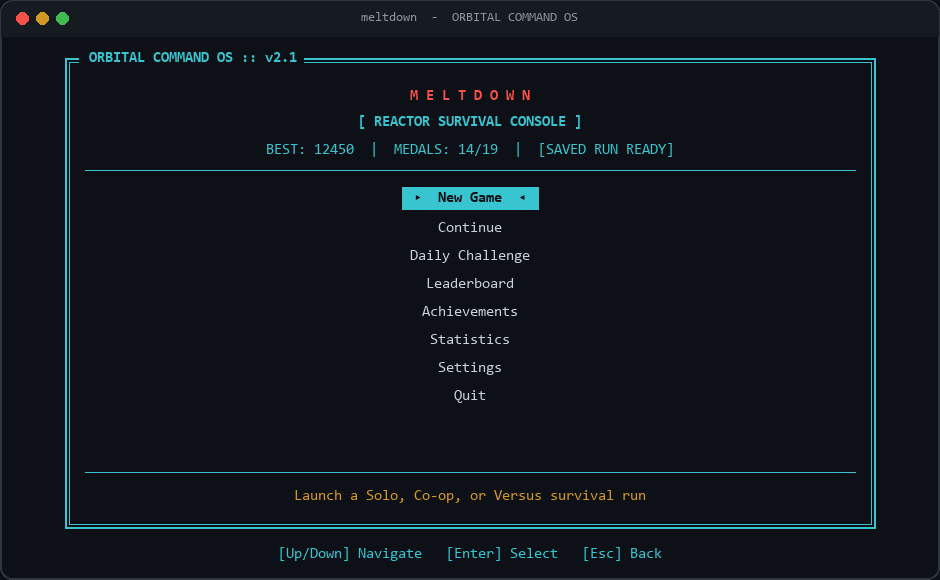 | 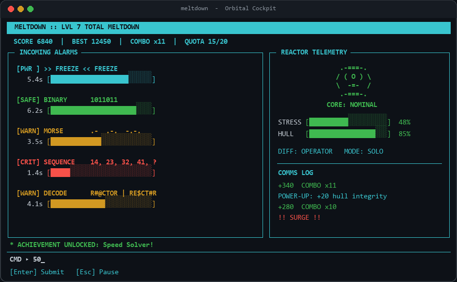 |
| **Boss Fight** | **Station Commendations** |
| 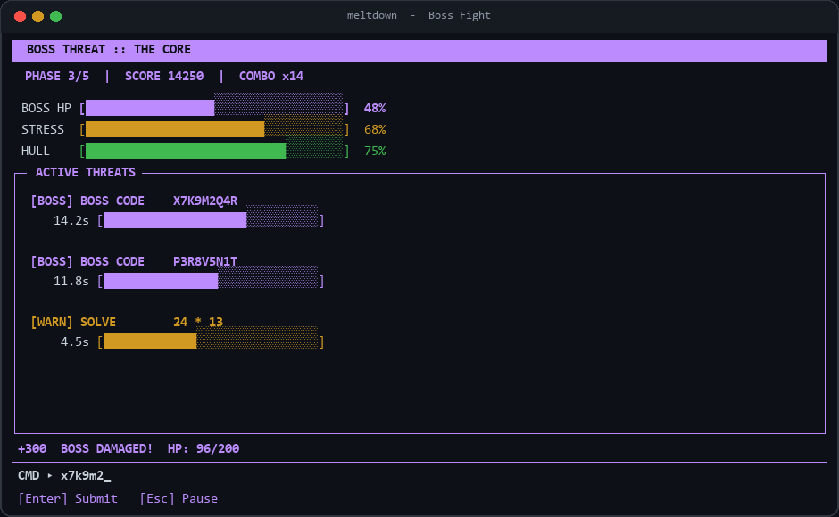 | 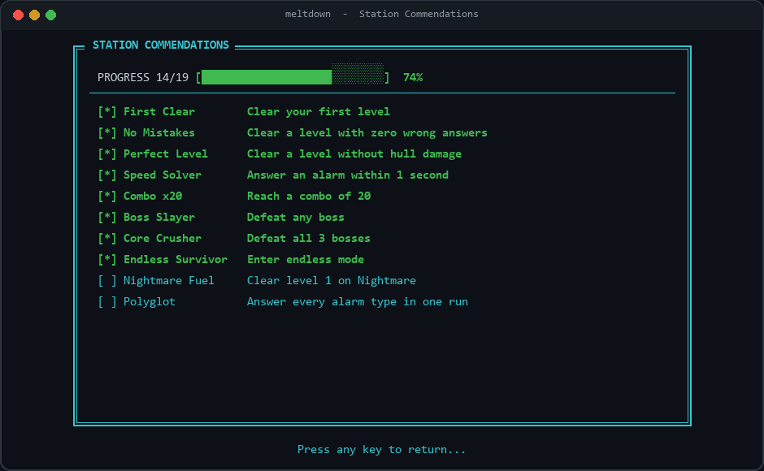 |
| **Sector Navigation** | **Field Manual (20 Alarms)** |
| 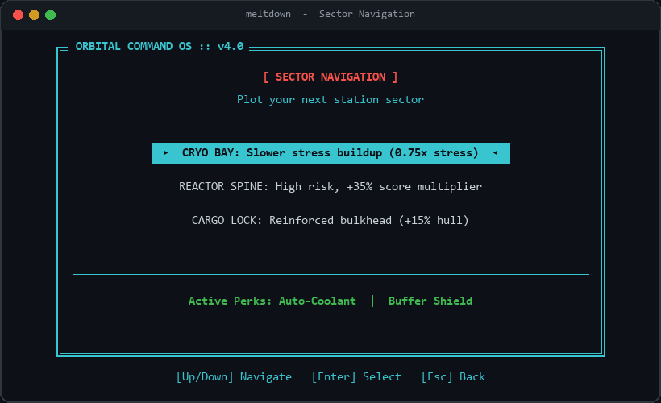 | 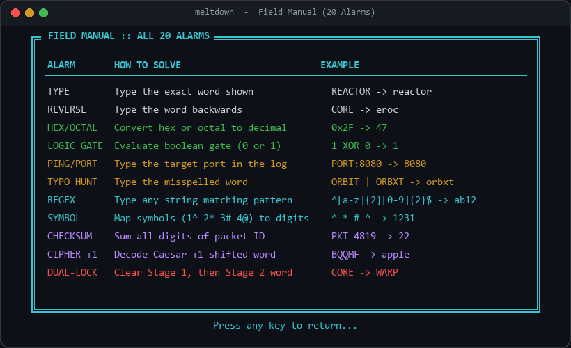 |
| **Replay Theater** | **Orbital Leaderboard** |
| 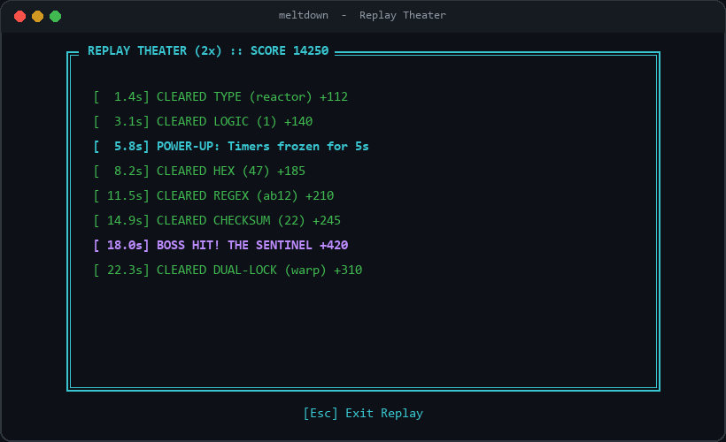 | 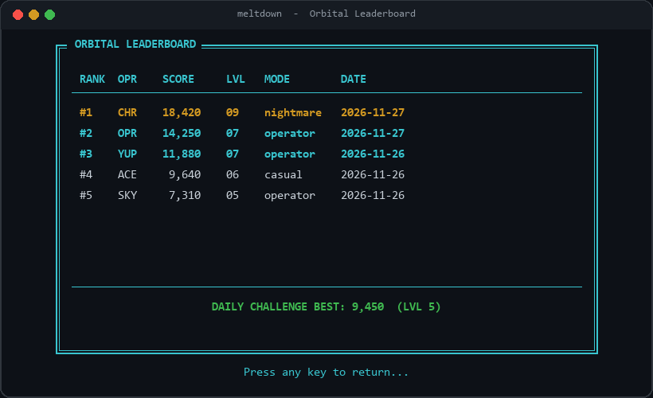 |
| **Lifetime Telemetry** | **System Settings** |
| 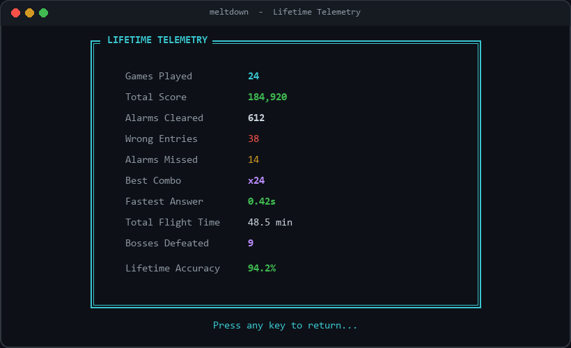 | 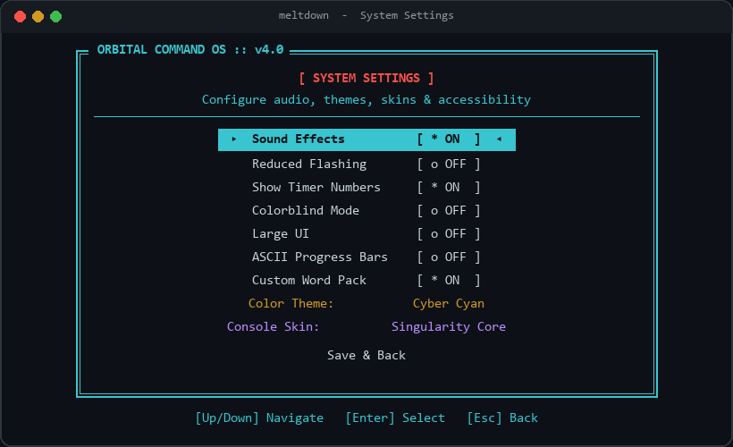 |
| **Mission Debrief** | **CRT Hazard Box Game Over** |
| 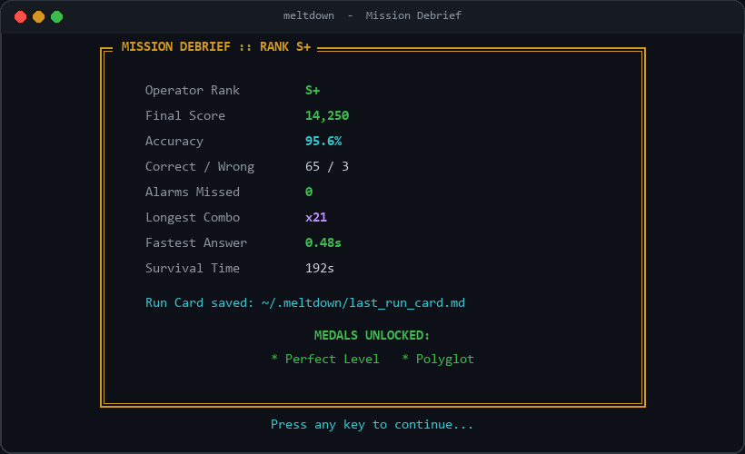 | 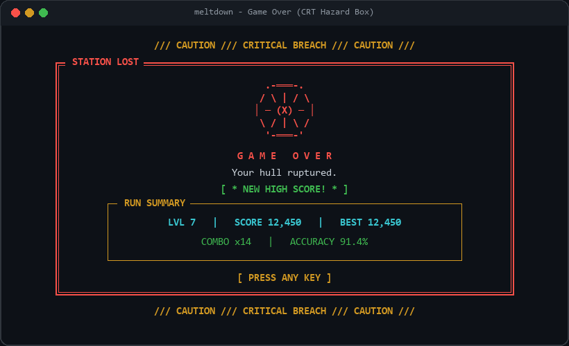 |

</div>

---

## 🛠️ Development Setup

```bash
git clone https://github.com/codest0411/meltdown.git
cd meltdown
python -m venv .venv
# Windows PowerShell: .venv\Scripts\Activate.ps1
# macOS / Linux:      source .venv/bin/activate
pip install -e ".[dev]"
```

### Running Tests

```bash
pytest
```

### Building Distribution Packages

```bash
python -m build
twine check dist/*
```

---

## 🔧 Troubleshooting

- **`Terminal error` or layout looks cut off:** Resize your terminal window to at least **80 × 24**.
- **`No module named '_curses'` on Windows:** Reinstall with `pip install meltdown-terminal` (or `pip install windows-curses`).
- **Colors look wrong or hard to read:** Enable **Colorblind Mode** or **Reduced Flashing** in `Settings`.
- **Save data location:** Persistent data (leaderboard, achievements, settings, saved runs) is stored in `~/.meltdown/data.json`. Override the directory by setting the `MELTDOWN_DATA_DIR` environment variable.

---

## 🤝 Contributing

Contributions are welcome! Please read [CONTRIBUTING.md](CONTRIBUTING.md) before opening a pull request.
See [ROADMAP.md](ROADMAP.md) for planned features and [CHANGELOG.md](CHANGELOG.md) for release history.


## 🔒 Security

See [SECURITY.md](SECURITY.md) for our security model and vulnerability reporting instructions.

## 📄 License

Released under the [MIT License](LICENSE).

## 🔗 Links

- **GitHub Repository:** https://github.com/codest0411/meltdown
- **Issue Tracker:** https://github.com/codest0411/meltdown/issues
- **PyPI Package:** https://pypi.org/project/meltdown-terminal/


---

<div align="center">

**☢️ MELTDOWN (`meltdown-terminal`)** · [MIT License](https://github.com/codest0411/meltdown/blob/main/LICENSE) · [PyPI](https://pypi.org/project/meltdown-terminal/) · [GitHub](https://github.com/codest0411/meltdown) · [Report a Bug](https://github.com/codest0411/meltdown/issues) · [Changelog](https://github.com/codest0411/meltdown/blob/main/CHANGELOG.md)

</div>


<div align="center">

Special Thanks for this Guy 
[Yup-45](https://github.com/yup-45)

Thanks Buddy !

</div>
